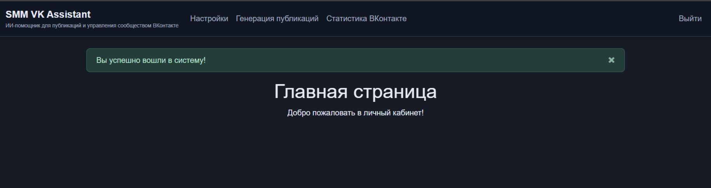
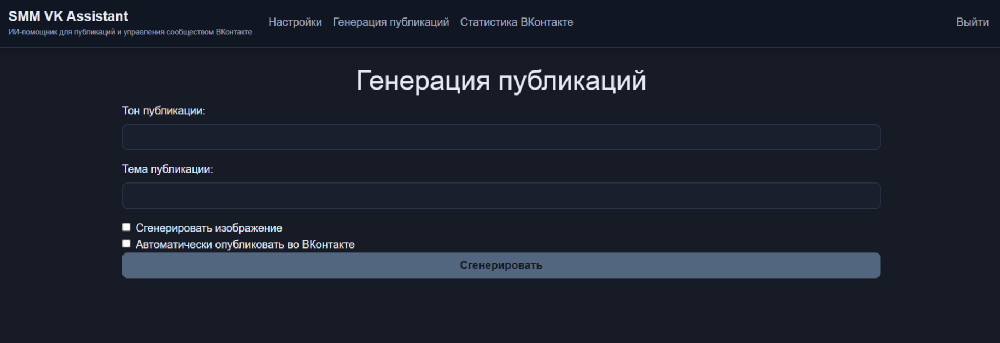
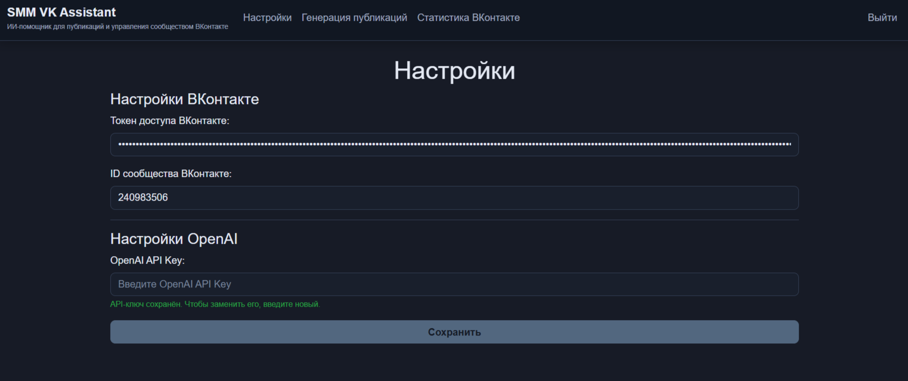
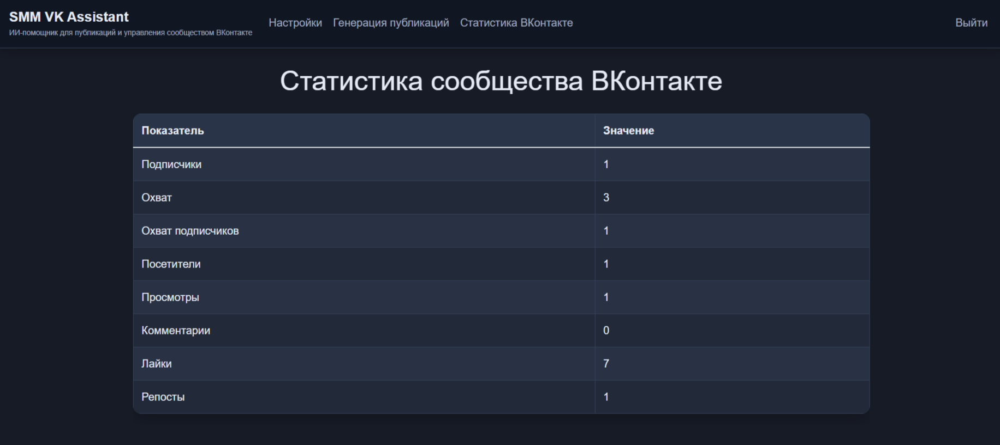

# 📱 SMM Assistant
**Веб-приложение для автоматизации работы SMM-специалиста с использованием OpenAI и ВКонтакте.**

SMM Assistant помогает создавать контент, генерировать изображения, публиковать материалы в сообществе ВКонтакте и отслеживать статистику. Приложение построено на Flask и объединяет инструменты генерации контента с возможностями VK API.

---
## 📑 Содержание
* [Возможности](#-возможности)
* [Скриншоты](#screenshots)
* [Технологический стек](#tech-stack)
* [Структура проекта](#-структура-проекта)
* [Установка и запуск](#installation)
* [Настройка API](#-настройка-api)
* [Безопасность](#-безопасность)
* [Статус проекта](#-статус-проекта)

---
## 🚀 Возможности

* **Регистрация и авторизация** — создание пользовательских аккаунтов и вход в приложение.
* **Генерация текстов** — создание публикаций с помощью OpenAI с учётом заданной темы и тона общения.
* **Генерация изображений** — создание иллюстраций для публикаций с помощью OpenAI.
* **Публикация во ВКонтакте** — размещение текстовых публикаций и изображений в сообществе через VK API.
* **Статистика сообщества** — получение статистических данных ВКонтакте.
* **Персональные настройки** — управление настройками приложения и пользовательским OpenAI API-ключом.
* **Шифрование API-ключей** — пользовательские OpenAI API-ключи шифруются перед сохранением в базе данных с использованием Fernet.

---
<a name="screenshots"></a>
## 🖼️ Скриншоты

### Панель управления



### Генерация публикации



### Настройки приложения



### Статистика ВКонтакте




---
<a name="tech-stack"></a>
## 🛠️ Технологический стек

| Категории              |        Технологии        |
|:-----------------------|:------------------------:| 
| Backend                |      Python, Flask       | 
| База данных            | SQLite, Flask-SQLAlchemy |
| Аутентификация         |       Flask-Bcrypt       |
| Формы                  |        Flask-WTF         |
| AI                     |        OpenAI API        |
| Соц сети               |          VK API          |
| HTTP-запросы           |         Requests         |
| Работа с конфигурацией |      python-dotenv       |
| Шифрование             |  Cryptography (Fernet)   |
| Frontend               |  HTML, CSS, Bootstrap    |


---

## 📂 Структура проекта

```text
SMM_Assistant/
│
├── app/
│   ├── __init__.py
│   ├── auth.py
│   ├── forms.py
│   ├── models.py
│   ├── smm.py
│   ├── templates/
│   └── static/
│
├── generators/
│   ├── image_gen.py
│   └── text_gen.py
│
├── social_publishers/
│   └── vk_publisher.py
│
├── social_stats/
│   └── vk_stats.py
│
├── docs/
│   └── screenshots/
│
├── encryption.py
├── config.py
├── main.py
├── migrate_add_openai_key.py
├── requirements.txt
├── .env.example
└── .gitignore
```

---
<a name="installation"></a>
## ⚙️ Установка и запуск

### 1. Клонирование репозитория

```text
git clone https://github.com/VikkMoor/SMM_Assistant.git
cd SMM_Assistant
```

### 2. Создание виртуального окружения

```text
python -m venv venv
```
Активация окружения:
```text
.\venv\Scripts\Activate.ps1
```

### 3. Установка зависимостей

```text
pip install -r requirements.txt
```

### 4. Настройка переменных окружения

Создайте файл `.env` на основе примера:

```text
Copy-Item .env.example .env
```
Заполните его собственными значениями. Инструкция по получению необходимых ключей приведена ниже.

### 5. Запуск приложения

```text
python main.py
```

После запуска откройте в браузере:

```text
http://127.0.0.1:5000
```

При первом запуске приложение создаёт необходимые таблицы SQLite.

---
## 🔑 Настройка API
Для работы приложения необходимы доступ к VK API и ключ шифрования Fernet.

### ВКонтакте

Создайте или выберите сообщество ВКонтакте.

Получите ключ доступа VK API с правами, необходимыми для используемых методов публикации и получения статистики.

Узнайте ID сообщества.

Укажите полученные значения в `.env`:

```text
VK_API_KEY=ваш_ключ_доступа_vk
VK_GROUP_ID=ваш_id_сообщества
```

### Ключ шифрования Fernet

Сгенерируйте ключ командой:
```text
python -c "from cryptography.fernet import Fernet; print(Fernet.generate_key().decode())"
```

Добавьте полученное значение в `.env`:
```text
FERNET_KEY=ваш_ключ_шифрования_fernet
```

Важно: сохраните сгенерированный ключ в надёжном месте. Не меняйте его после сохранения пользовательских API-ключей в базе данных, иначе расшифровать ранее сохранённые значения не получится.

### OpenAI API
OpenAI API-ключ пользователь указывает непосредственно в разделе настроек приложения. После сохранения ключ шифруется и хранится в базе данных.

---
## 🔒 Безопасность

* Файл `.env` исключён из Git.
* Пользовательские OpenAI API-ключи шифруются с помощью Fernet.
* Пароли пользователей обрабатываются с использованием Flask-Bcrypt.
* Сгенерированные изображения и локальные файлы базы данных не добавляются в репозиторий.

Не публикуйте API-ключи, пароли и другие конфиденциальные данные в открытом доступе.

Перед развёртыванием приложения в публичной среде необходимо дополнительно настроить секретный ключ Flask, отключить режим отладки и проверить параметры безопасности сервера.

---
## 📌 Статус проекта

**Основная функциональность реализована и протестирована локально.**

Проект включает генерацию текстов и изображений, интеграцию с VK API, публикацию контента, получение статистики, регистрацию пользователей и хранение зашифрованных пользовательских API-ключей.

Следующий этап — развёртывание приложения на PythonAnywhere и проверка работы в публичной среде.
